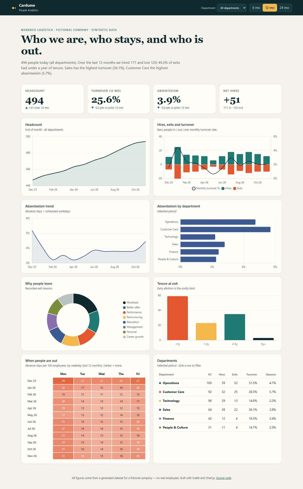
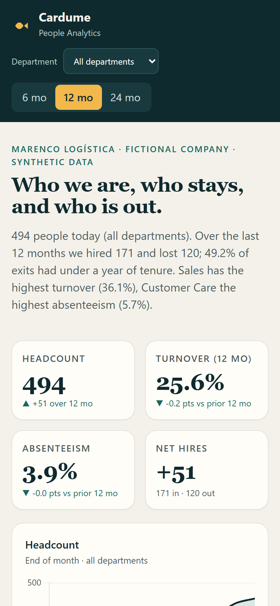

# Cardume — People Analytics

An interactive HR dashboard covering **headcount, turnover and absenteeism** for a fictional logistics company ("Marenco Logística"). Filter by department and period (6 / 12 / 24 months); every KPI, chart and table recalculates.

**Live demo:** https://alissonlittig.github.io/cardume-people/

> All data is synthetic, generated by a seeded script. No real people or companies are described.





## What it shows

- Headcount, 12-month turnover and absenteeism KPIs, each compared with the prior period
- Hires vs. exits with the monthly turnover rate
- Absenteeism trend and ranking by department
- Exit reasons and tenure at exit (early attrition)
- Weekday absence heatmap and a clickable department table

## Stack

Svelte 5 · Chart.js · Vite · Vitest. Data is a static `public/data.json` built by `scripts/generate-data.mjs` (36 months, 6 departments, deterministic seed).

## Run it

```bash
npm install
npm run data    # regenerate the dataset (optional, it is committed)
npm test        # metric maths + dataset invariants
npm run dev
npm run build
```

CI (`.github/workflows/pages.yml`) runs tests and the build on every push, then deploys `dist/` to GitHub Pages from `main`.

## Metric definitions

- **Turnover** = exits ÷ average headcount over the window (annual rate for 12 months).
- **Absenteeism** = absence days ÷ scheduled workdays (average headcount × working days).
- **Early attrition** = share of exits with less than one year of tenure.
